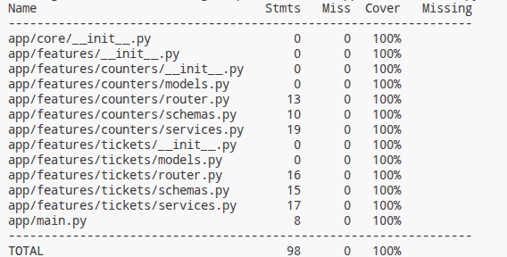

TEMPLATE FOR RETROSPECTIVE (Team 8)
=====================================

The retrospective should include _at least_ the following
sections:

- [process measures](#process-measures)
- [quality measures](#quality-measures)
- [general assessment](#assessment)

## PROCESS MEASURES 

### Macro statistics

- The number of stories committed and done by the team were both 2
- The team committed and completed 6 story points
- Hours of work estimated vs actually spent: 40h 30m vs 36h 5m

**Remember**  a story is done ONLY if it fits the Definition of Done:
 
- Unit Tests passing
- Code review completed
- Code present on Git
- End-to-End tests performed

> Please refine your DoD 

### Detailed statistics

| Story  | # Tasks | Points | Hours est. | Hours actual |
|--------|---------|--------|------------|--------------|
| _#0_   |    8    |    -   |    20h 30m |   15h 50m    |
| n. 1   |    5    |    3   |   10h      |    11h 15m   |
| n. 2   |    5    |    3   |    10h     |     9h       |
   

> place technical tasks corresponding to story `#0` and leave out story points (not applicable in this case)

- Hours per task average, standard deviation (estimate and actual)

|            |  Mean  | StDev |
|------------|--------|-------|
| Estimation |  2.250 | 2.005 | 
| Actual     |  1.801 | 1.885 |

- Total estimation error ratio: sum of total hours spent / sum of total hours effort - 1: `-0.11`

    $$\frac{\sum_i spent_{task_i}}{\sum_i estimation_{task_i}} - 1$$

- Absolute relative task estimation error: sum( abs( spent-task-i / estimation-task-i - 1))/n: `0.30`

    $$\frac{1}{n}\sum_i^n \left| \frac{spent_{task_i}}{estimation_task_i}-1 \right| $$

## QUALITY MEASURES 

For the first sprint, the team didn't keep track time separately for unit, integration and E2E testing. This is a problem that will be fixed
in the next sprint.

- Testing:
  - Total hours estimated: 10h
  - Total hours spent: 11h
  - Number of test cases: 71
  - Coverage: 100% (pytest results combined with coverage run below)

- Code review 
  - Total hours estimated: 2h
  - Total hours spent: 1h

## ASSESSMENT

- What caused your errors in estimation (if any)?
  - Since this was our first sprint, we overestimated the setup tasks, which went smoother than expected.
  - We considered the backend and frontend more difficult than they actually were, and underestimated the time needed for frontend testing, since we had to learn how to test it.
  - We were working with some new technologies, and some tasks had inaccurate estimates as a result.

- What lessons did you learn (both positive and negative) in this sprint?
  - Positive
    - Keeping most of the tasks small made daily progress easy to track.
    - Time tracking turned out to be less of a chore and more helpful as a self-assessment tool than we thought.
    - A good task division and assignment were achieved.

  - Negative
    - Logging all test activities under a single generic task (instead of separating them) prevented us from accurately tracking how much effort went into each layer for the quality measures report.
    - The high standard deviation in task hours indicates that some tasks were quick and atomic, while others grouped too much work together.
    - It is better to split backend testing into integration and unit testing for better estimation.
    - When coordinating work within a week, the different lecture times of team members made it hard to assign tasks in a way that made working hours feasible.
    - By relying on task effort and estimates, quality sometimes decreased as a result (there was a tendency not to exceed the estimated time, so the most basic version possible was considered OK).

- Which improvement goals set in the previous retrospective were you able to achieve?
  - N/A
  
- Which ones you were not able to achieve? Why?
  - N/A

- Improvement goals for the next sprint and how to achieve them (technical tasks, team coordination, etc.)
  - Track unit, integration and E2E testing effort and test counts separately. We can achieve this during the next sprint planning by creating distinct subtasks for every story, explicitly labeled "Unit Test", "Integration Test" and "E2E Test", rather than using a single generic task.
  - Reduce task estimation errors and task-size variance. We can achieve this by using Sprint 1's actual hours as a calibration base and breaking down tasks estimated to take too many hours into smaller subtasks.
  - Don't try to assign every task to contributors perfectly at the beginning. It is better to adjust task assignments during the sprint according to the actual time spent.
  - Improve quality, especially in testing, by setting an internal standard for the number of test cases and by having better test structures for the frontend.
  - Better prepare for the demo, for example, by deciding in advance who will present each part. Having an internal demo beforehand could also help.

- One thing you are proud of as a Team!!
  - Delivering 100% of our committed stories and story points.
  - Successful team coordination despite the absence of a team member.
  - Very good teamwork, together with excellent communication every evening via WhatsApp. This led to completing the planned work.
  - We completed all the functionalities we set out to deliver, even while working with different and new technologies and under a tight schedule.
  - We all helped each other to reach a common objective.

---
### Coverage results
Coverage run results have been combined with pytest ones using `coverage combine` to account for API, UI and server tests.

